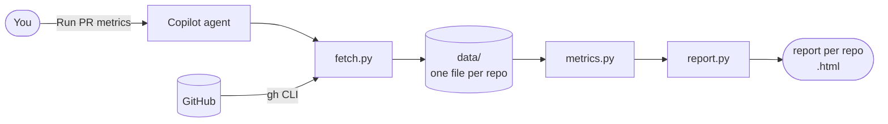
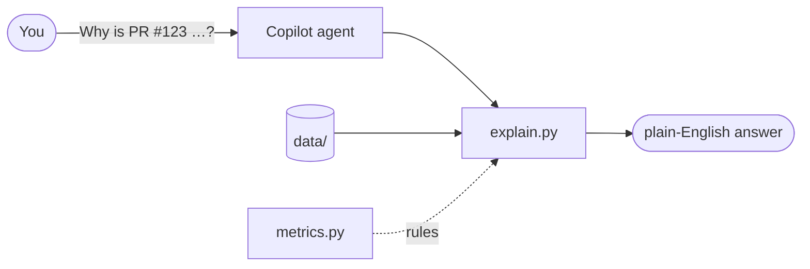

# gh-pr-metrics

A GitHub Copilot agent that shows how your team's pull requests (PRs) move through review:
time to merge, where the time goes, skipped reviews, reverts, PR size and unfinished work.
Works with github.com and company GitHub servers. Every number is defined in [METRICS.md](METRICS.md).

## Flow Diagram



## Start in 3 steps

1. **Install** VS Code with GitHub Copilot, [Python 3.11+](https://www.python.org/downloads/)
   and [GitHub CLI](https://cli.github.com), then sign in: `gh auth login --hostname <your GitHub server>`
2. **Copy** `pr-metrics.config.sample.toml` to `pr-metrics.config.toml` and fill it in.
   Each setting is explained in the file. It stays on your machine.
3. **In Copilot Chat,** pick the **gh-pr-metrics** agent and type a request below.
   It asks you to confirm once, then builds the report.

| Type                                          | You get                                              |
| --------------------------------------------- | ---------------------------------------------------- |
| Run PR metrics                                | The latest periods                                   |
| Run PR metrics since start                    | Every period since `history_start`                   |
| Run PR metrics for the last 3 months          | The last 3 months (or "6 weeks")                     |
| Run PR metrics from 2 Nov 2026 to 15 Nov 2026 | That range, beside the same number of days before it |
| Add "full refresh" to any of the above        | All data downloaded again                            |

## Read and check the report

Each repo gets its own report. Open `output/<date-time>/report-<owner>-<name>.html` in any browser.

- Each table answers one question. Each column is a period, shown by its dates.
- Each cell shows a typical PR, a slow PR, and how many PRs: `median · p75 (count)`.
- ▼ means better than the period before, ▲ means worse, = means the same.
  Look at several periods, not just one.
- Notes at the bottom explain anything that affects the numbers.
- The PR list shows every PR behind the numbers. Filter it by period, status or author.

**To check a number:** tick **Show calculation details** to see each PR's times.
Pick a period, click **Download shown rows as CSV**, and open it in Excel.

## Ask about a number



Ask the agent in Copilot Chat, for example:

- "Why is owner/repo #123's waiting for first review 1.97 days?"
- "Why isn't #456 counted?"
- "Did it consider CI results for #123?"

It answers from that PR's saved data and the rules in `metrics.py`, without fetching.
Without Copilot, run `python scripts/explain.py --repo owner/repo --pr 123`
(add the same option as the report, e.g. `--since-start`).
If you disagree with a rule itself, the rules are in [METRICS.md](METRICS.md): raise it with the tool's owner.

## If it stops

| Message                                    | Do this                                                                      |
| ------------------------------------------ | ---------------------------------------------------------------------------- |
| gh is not signed in                        | Run the `gh auth login` command shown                                        |
| config file not found                      | Do step 2                                                                    |
| settings changed since the last full fetch | Say yes when the agent offers a full fetch                                   |
| GitHub kept failing                        | GitHub is overloaded; try again later                                        |
| … is before history_start                  | Ask for later dates, or set an earlier `history_start` and do a full refresh |
| No PRs found for login(s)                  | Check those logins in the config                                             |

## Project structure

```
gh-pr-metrics/
├── .github/agents/gh-pr-metrics.agent.md   the Copilot agent
├── scripts/
│   ├── fetch.py      gets PRs from GitHub (gh CLI)
│   ├── metrics.py    calculates every number in METRICS.md
│   ├── report.py     builds one HTML report per repo
│   ├── explain.py    explains one PR's numbers in plain English
│   └── check_same.py confirms a code change left the results unchanged
├── METRICS.md        what every number means, with sources
├── COMPARISON.md     what's improved over pr-metrics-agent
├── docs/             maintainability baselines and reviews
├── pr-metrics.config.sample.toml   settings template
├── pr-metrics.config.toml   your settings      (never committed)
├── data/                    saved PRs per repo (never committed)
└── output/                  reports per run    (never committed)
```

Built as a successor to [pr-metrics-agent](https://github.com/thomas3577-star/pr-metrics-agent): see [what's improved](COMPARISON.md).
